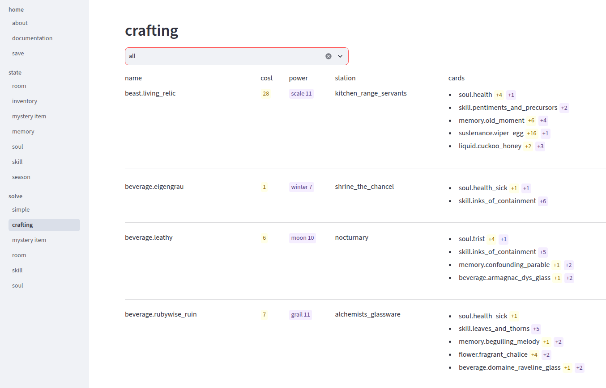

# 'book of hours' solver

This is a helper app for the pc game ['book of hours'](https://weatherfactory.biz/book-of-hours/).

For a given game state, this app will find available actions and combination of cards that will trigger the action.



## how to run

### web version https://book-of-hours-solver.streamlit.app/

No installation needed. Just open it in browser.
You may need to wait for ~20s for it to "wake up from inactivity".

The app is hosted for free on [streamlit.io](https://streamlit.io/).
Depending on when you read this, it may no longer be available. See next.

### run locally

Clone this repo, or download it as zip file and extract.

Install python 3.x (tested with 3.13).

Install app requirements ('streamlit' framework).

```bash
# command 'pip' is part of python
pip install -r requirements.txt
```

Run the app

```bash
# command 'streamlit' was installed by 'pip install ..'
streamlit run streamlit_app.py
```

It will run the local web server and open a browser tab pointing to it.

### command-line (for experts)

Follow the python/pip install steps from previous section.

Update `main.py` to log your progress throughout the game.

Run solver as a command-line script:

```
python main.py
```

Comment/uncomment lines in the script to run different solvers or try different input configurations.

## usage

For app documentation, see 'home / documentation' menu in app itself or
[documentation.py](pages/home/documentation.py).

## bit of a background

As most players, I started taking notes in notepad. Then went to spreadsheet
to calculate 'best' of each kind (strongest lantern beverage). And then you
realize that you need to model the whole inventory, as actions may accept multiple items
of the same kind and you need to track how many items you have of what.

I started to model the game logic in python classes/objects. With many, many,
refactors and restarts..

For solver, I've spent some time on 'constraint programming' with 'ilog cplex'
(free version too limited) and 'minizinc' (too slow for many small problems).
Eventually, I've end up with simple in-memory backtrack in pure python.

I wrote the solver for myself and I've used interactive python prompt with a single
script to track progress through the game (`main.py`).

When I finished, I decided to publish the solver and add web ui for more comfort.
It was also an opportunity to learn 'streamlit'.

In the code, you will notice that for a long time, command-line for the only
use-case and web ui was an afterthought. At that point, I had no motivation
to adapt model better to 'streamlit' use-case. It is as it is..
